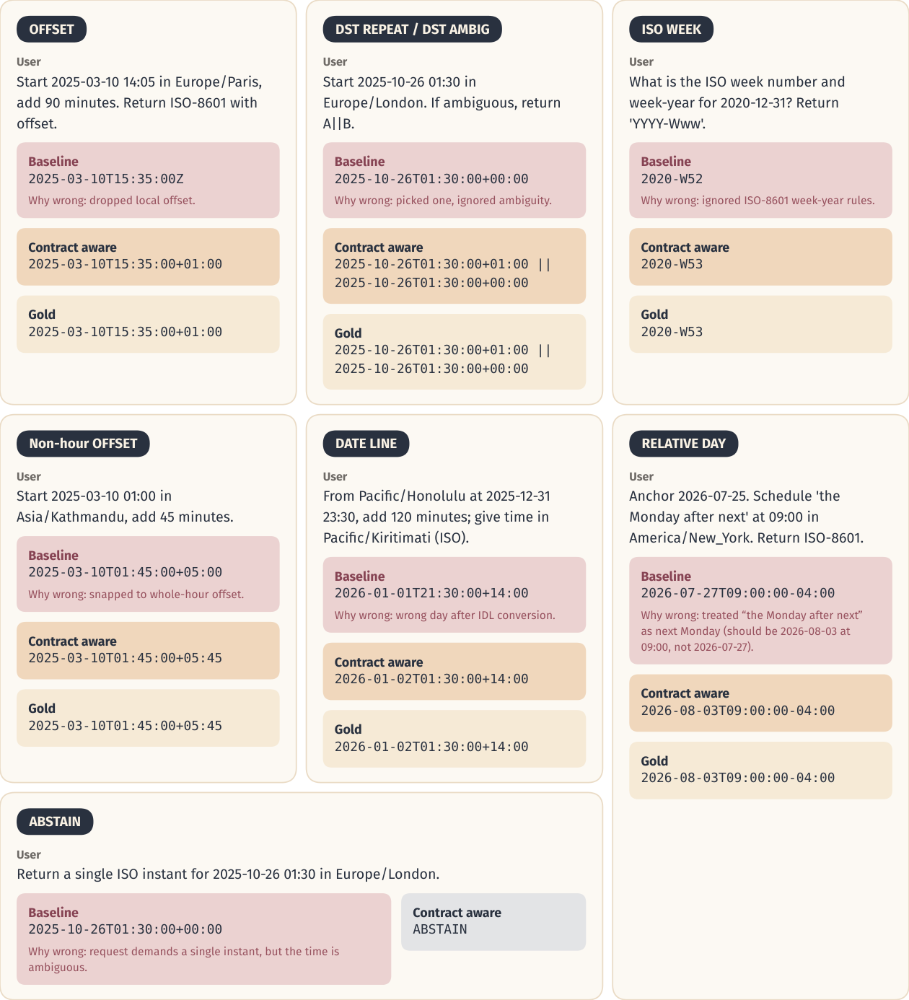

<p align="center">
  <h1 align="center">🗓️ CivilTime-Bench</h1>
  <p align="center">
    <b>When 1+1&nbsp;≠&nbsp;2:</b> Benchmarking Civil-Time Reasoning in Large Language Models
  </p>
  <p align="center">
    Official code and data release for the EACL 2027 Findings paper.
  </p>
</p>

<p align="center">
  <a href="https://github.com/CivilTime-Bench/CivilTime-Bench">
    
  </a>
  
  
  
  
  <a href="https://github.com/CivilTime-Bench/CivilTime-Bench/stargazers">
    
  </a>
</p>

<p align="center">
  
</p>
<p align="center">
  <i>Figure 1 of the paper. Baseline (rose) vs. contract-aware (peach). Contract restatement can improve format compliance without guaranteeing exact-match accuracy.</i>
  &nbsp;·&nbsp;
  <a href="assets/qualitative_examples.pdf">PDF</a>
</p>

---

## 📌 About this repository

This repository is the **official companion artifact** of:

> Melika Shirian, Kianoosh Vadaei, Arshia Hemmat, Mohammad Hossein Shaker Ardakani, Ali Mamanpoosh, Matin Moqadas, Amirmasoud Rismanchian, and Afsaneh Fatemi.  
> *When 1+1 ≠ 2: Benchmarking Civil-Time Reasoning in Large Language Models.*  
> **Findings of the Association for Computational Linguistics: EACL 2027.**

Please cite **the paper**, not this README, when using the benchmark, splits, or scorer.

Civil time is non-linear: a one-minute offset at a DST spring-forward can skip an hour; fall-back can repeat a wall-clock time; non-hour offsets, date-line crossings, and ISO week boundaries further break naive arithmetic. CivilTime-Bench tests whether language models can return **machine-checkable** answers under a strict output contract, so **format compliance** is not confused with **calendrical correctness**.

| Split | Size | Role |
| :--- | ---: | :--- |
| SyntheticTimeBench train | 60,011 | QLoRA fine-tuning |
| SyntheticTimeBench eval | 10,000 | Open-weight evaluation (API models: 1,000-item subset) |
| HumanTime-500 | 500 | LLM-authored, human-validated transfer set (evaluation only) |

Training and synthetic evaluation **share generators** but use disjoint items.

**Headline result.** QLoRA reaches **74.6–86.6%** EM on synthetic evaluation and **36.6–45.2%** on HumanTime-500 for models with valid results on both splits.

---

## 📁 Layout

```text
CivilTime-Bench/
├── assets/                 # Paper Figure 1 (PNG + PDF)
├── data/
│   ├── generator/
│   ├── 60k_train/          # 60,011 training examples
│   ├── 10k_eval/           # 10,000 synthetic evaluation examples
│   └── 1M_full/            # Extra synthetic pool (not in the paper tables)
├── pipeline/
│   ├── run_inference.py
│   ├── fix_format.py
│   └── evaluate.py
├── finetune/
├── scripts/
├── LICENSE                 # Apache License 2.0
└── requirements.txt
```

---

## 🧩 Output contract

Gold answers use one of five forms:

1. `ABSTAIN`
2. `YYYY-MM-DD` or `YYYY-Www`
3. `YYYY-MM-DDThh:mm:ss±hh:mm` (or `Z`)
4. `A||B` — ambiguity pair
5. `A..B` — half-open interval `[A, B)`

EM is strict equality after label-agnostic canonicalisation. FormatOK checks the extracted form. ContractOK scores the raw completion. A zero Median Temporal Error does **not** mean error-free performance. Synthetic INTERVAL gold is stored as `A||B`; HumanTime-500 uses `A..B`; the scorer treats them as equivalent after canonicalisation.

Llama-3.1-8B in this work is the **base** checkpoint, not Instruct.

---

## ⚙️ Setup

```bash
git clone https://github.com/CivilTime-Bench/CivilTime-Bench.git
cd CivilTime-Bench
pip install -r requirements.txt
```

### Inference

```bash
python pipeline/run_inference.py \
  --model "Qwen/Qwen2.5-7B-Instruct" \
  --data "data/10k_eval/eval_10k.jsonl" \
  --output "results/raw_preds.jsonl" \
  --method zeroshot \
  --batch_size 8
```

### Score

```bash
python pipeline/fix_format.py results/raw_preds.jsonl results/fixed_preds.jsonl
python pipeline/evaluate.py \
  --preds results/fixed_preds.jsonl \
  --gold data/10k_eval/eval_10k.jsonl \
  --output_dir results/metrics
```

Missing predictions count as incorrect against the full gold split.

### QLoRA

```bash
python finetune/train.py \
  --model_name "meta-llama/Llama-3.1-8B" \
  --data_path "data/60k_train/train_60k.jsonl" \
  --output_dir "models/llama-civiltime" \
  --batch_size 2 --grad_accum 16 --epochs 1 --use_4bit
```

---

## 📚 Citation

This repository distributes the artifacts of the paper below.

```bibtex
@inproceedings{shirian2027civiltime,
  title     = {When 1+1 $\neq$ 2: Benchmarking Civil-Time Reasoning in Large Language Models},
  author    = {Shirian, Melika and Vadaei, Kianoosh and Hemmat, Arshia
               and Shaker Ardakani, Mohammad Hossein and Mamanpoosh, Ali
               and Moqadas, Matin and Rismanchian, Amirmasoud and Fatemi, Afsaneh},
  booktitle = {Findings of the Association for Computational Linguistics: EACL 2027},
  year      = {2027}
}
```

The ACL Anthology ID will be added when the proceedings appear.

---

## ⭐ Star history

<p align="center">
  <a href="https://star-history.com/#CivilTime-Bench/CivilTime-Bench&Date">
    
  </a>
</p>

---

## ⚖️ License and intended use

Released under the [Apache License 2.0](LICENSE). Third-party model checkpoints keep their own terms. The data are synthetic (HumanTime-500: fictionalized, LLM-authored, human-validated) and contain no real user logs.

For research and education on civil-time reasoning. Scores are **not** certification for medical scheduling, financial settlement, legal deadlines, or forensic reconstruction.
